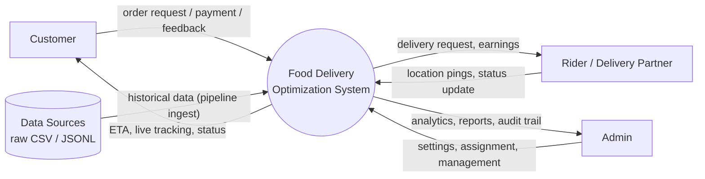
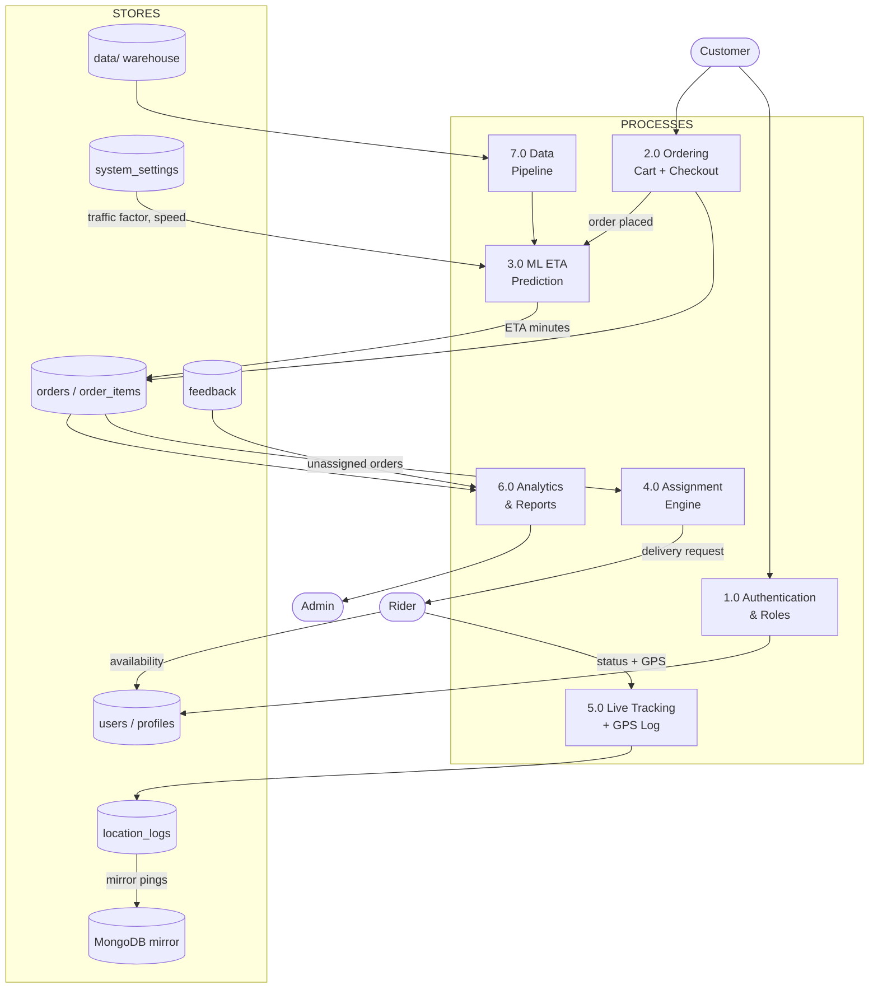

# Data Flow Diagrams (DFD) — Food Delivery Optimization System

## Level 0 — Context Diagram

The whole system as one process, with the four external entities.

## Level 1 — Major Sub-Processes

## Level 1 — Process Descriptions

| # | Process | Inputs | Outputs | Key Files |
|---|---------|--------|---------|-----------|
| 1.0 | Authentication | login form, staff code | session, role redirect | `app/blueprints/auth.py` |
| 2.0 | Ordering | cart items, address, payment | order + order_items rows | `app/blueprints/customer.py` |
| 3.0 | ML ETA Prediction | distance, prep time, traffic, hour | `estimated_delivery_min` | `ml/predictor.py`, `app/services/ml_bridge.py` |
| 4.0 | Assignment | unassigned orders, rider states | assigned order + audit entry | `app/services/assignment.py`, `simulator.py` |
| 5.0 | Tracking | rider GPS pings, status changes | location_logs rows, map view | `app/services/tracking.py` |
| 6.0 | Analytics | orders, feedback, audit | charts, CSV reports | `app/services/analytics.py` |
| 7.0 | Data Pipeline | raw CSV/JSONL | cleaned files, warehouse, ML dataset | `scripts/clean_data.py`, `ingest_*.py` |

## Data Dictionary (main flows)

| Flow | Content | Source → Sink |
|---|---|---|
| order-request | items, qty, address, payment method | Customer → 2.0 |
| eta-prediction | minutes (integer), source = "ml" | 3.0 → orders table → Customer |
| assignment-request | order id, ranked riders (distance + workload) | 4.0 → Rider |
| gps-ping | lat, lon, speed, seq, order id | Rider → 5.0 → location_logs |
| feedback | rating 1–5, comment | Customer → feedback table |
| cleaned-dataset | 14,908 orders, 29,100 GPS pings | 7.0 → data/cleaned |
