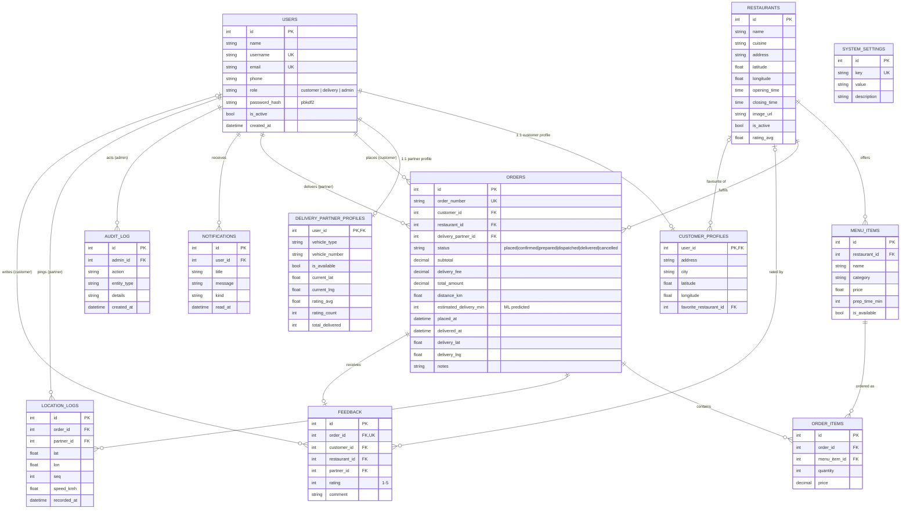

# ER Diagram — Food Delivery Optimization System

Entity-Relationship diagram of the 12 application tables
(SQL Server database: `food_delivery_sys`).

## Entities and Relationships (Mermaid)

## Cardinality Summary

| Relationship | Cardinality | Note |
|---|---|---|
| User → CustomerProfile | 1 : 1 | one profile per customer account |
| User → DeliveryPartnerProfile | 1 : 1 | one profile per rider account |
| User → Orders | 1 : N | as customer or as delivery partner |
| Restaurant → MenuItems | 1 : N | 12 restaurants, 125+ items |
| Order → OrderItems | 1 : N | line items of the bill |
| Order → Feedback | 1 : 1 | one rating per order (unique) |
| Order → LocationLogs | 1 : N | GPS pings during delivery |
| MenuItem → OrderItems | 1 : N | which item was bought |
| User → Notifications | 1 : N | bell inbox |

> Roles live in `users.role` (customer / delivery / admin), so the three
> account types share one authentication table — role guards protect every
> dashboard.
