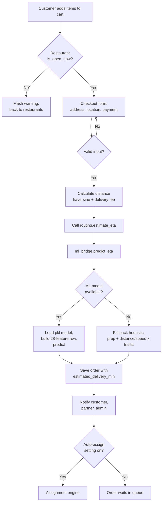
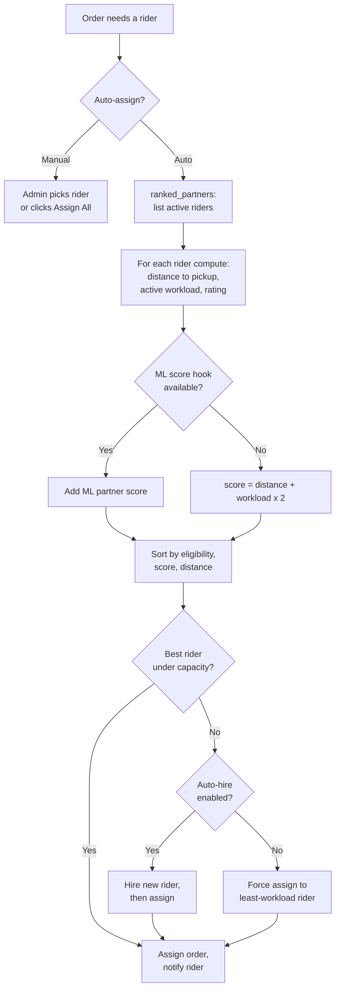
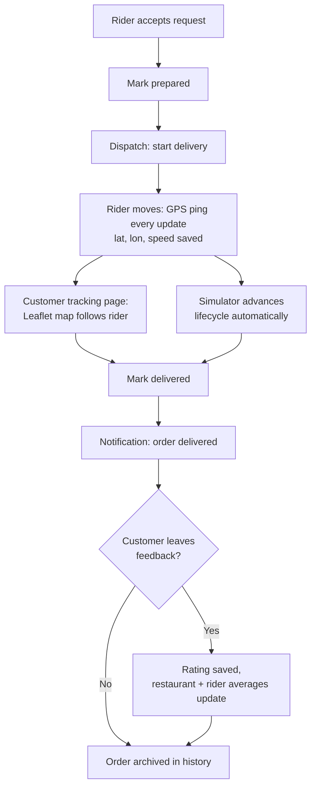
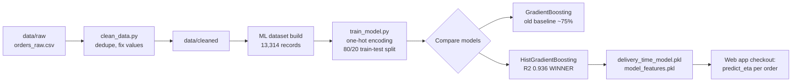
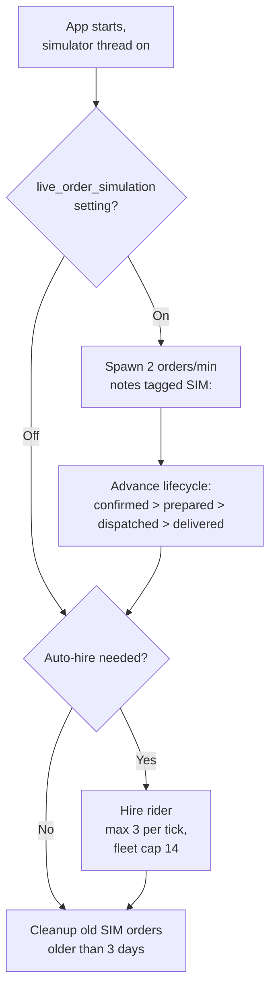

# Flowcharts — Food Delivery Optimization System

## 1. Order Placement + ML ETA (Customer Checkout)

## 2. Order Assignment (Distance + Workload Scoring)

## 3. Delivery Lifecycle (Rider + Tracking)

## 4. ML Model Pipeline (Training → Prediction)

## 5. Live Demo Simulator (Background Thread)

> Simulator-tagged orders (`SIM:` prefix in notes) never touch real customer
> orders — demo data stays separate.
